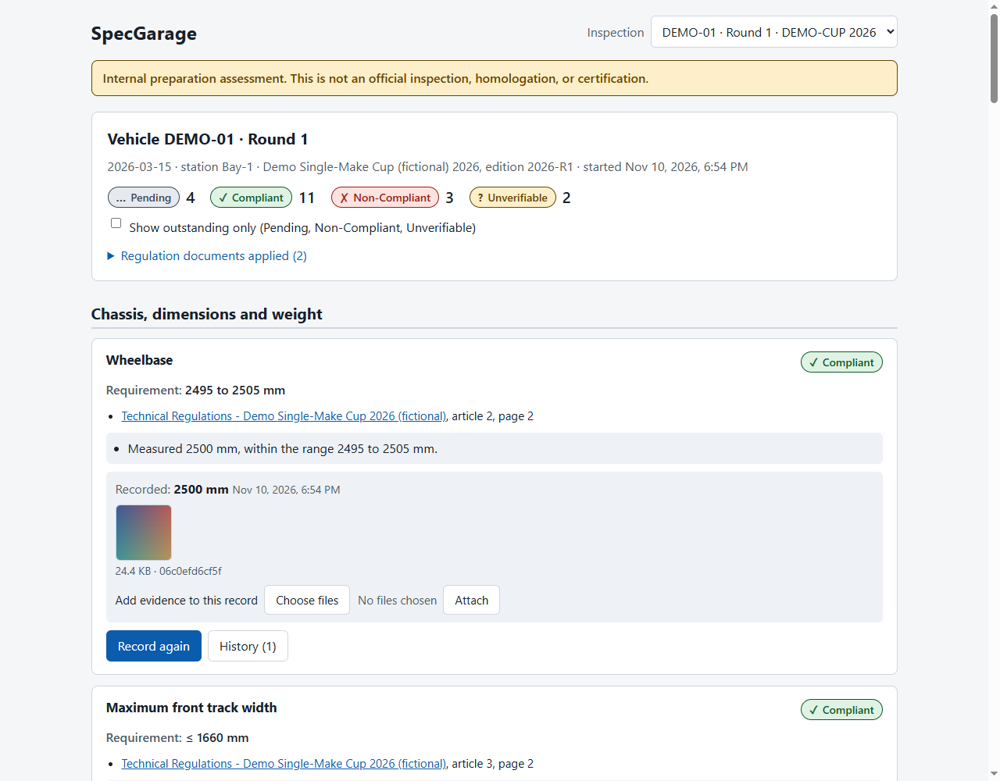
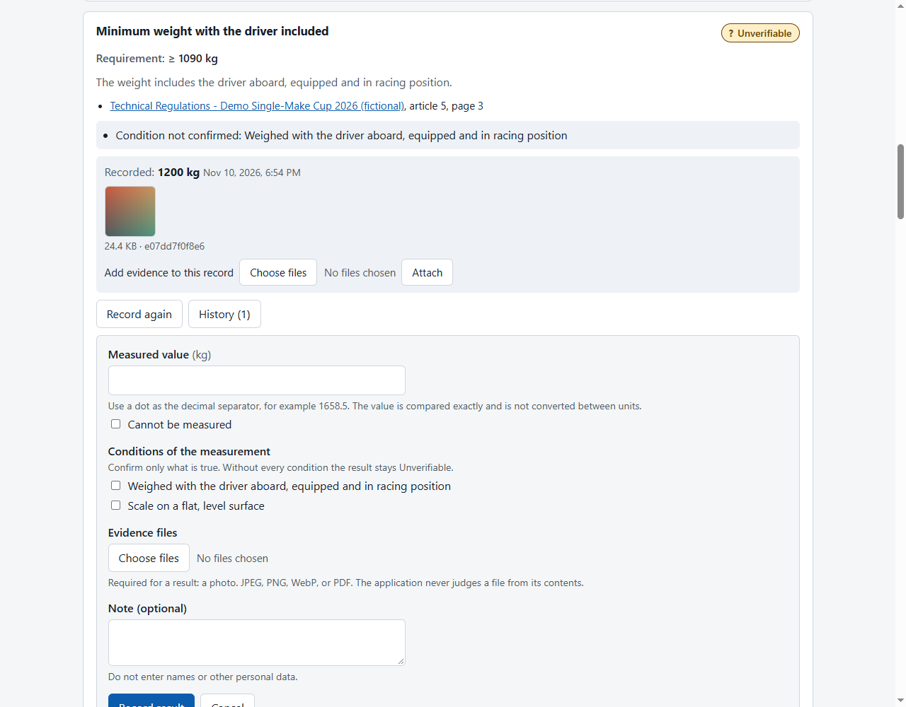
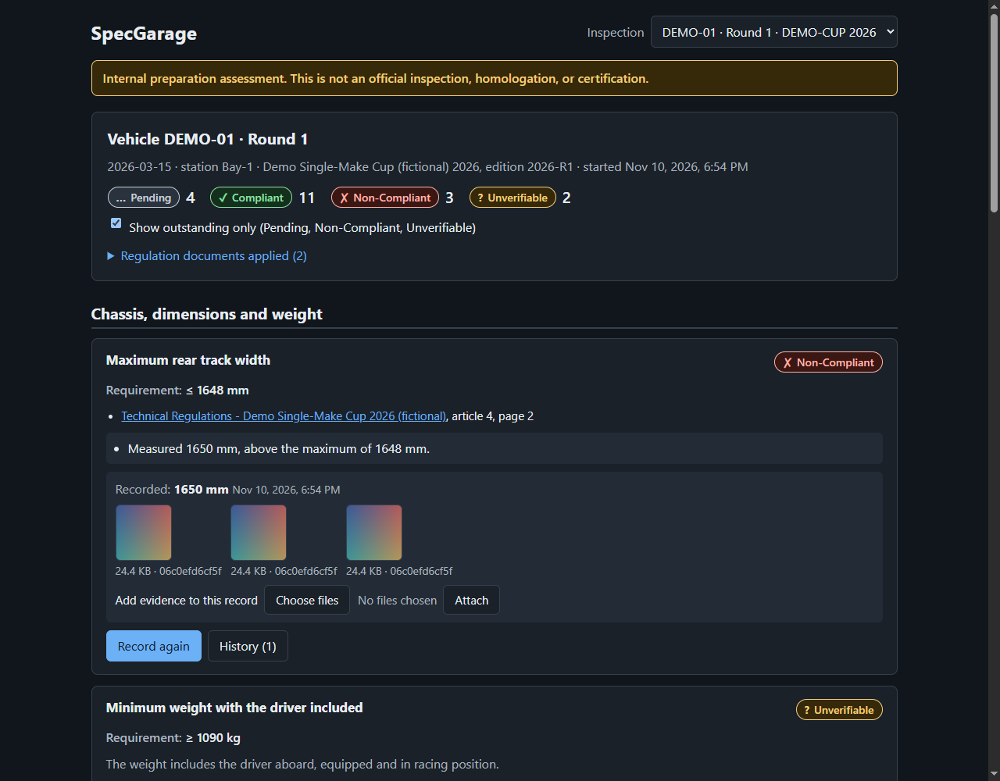
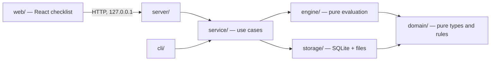

# SpecGarage

SpecGarage is an offline tool for vehicle preparers and technical leads in single-make racing categories, designed first around Argentine categories and the way their regulations are organized: a technical regulation, a sporting regulation, official annexes, and a per-event particular regulation. It turns a category's regulations into a preparation checklist for one vehicle at one event, records measurements and evidence against each requirement, and keeps every result traceable to the regulation article and edition it was judged against. It supports a team's own preparation work; it does not replace official technical inspection, homologation, or certification.

> **Status: first functional release (v0.1.0).** It covers one complete workflow: import a category's rules, start an inspection, record measurements and verdicts with evidence, and see what is compliant, non-compliant, unverifiable, or still pending. See [Known limitations](#known-limitations) and [ROADMAP.md](ROADMAP.md) for what is not built yet.

## Key Features

**Implemented**

- Describe a category's requirements in a validated JSON _rulepack_ and import it as an immutable, hashed _edition_; a change to the rules is a new edition and never alters earlier inspections.
- Register vehicles by internal code and start an inspection for a vehicle at an event, pinned to one edition.
- A checklist grouped by vehicle system with numeric limits (minimum, maximum, range, compared exactly) and manual verdicts (obligation, prohibition, visual, procedural).
- Measurement conditions that must be confirmed (for example "weighed with the driver aboard"), and required evidence (photos or PDFs). Without them a result is Unverifiable, never guessed.
- Every result shows its reasons, the rule values used, and a link that opens the stored regulation PDF at the cited page.
- Append-only history of every observation, evidence file, and evaluation.
- Command-line interface for rulepacks, vehicles, and inspections; a local web interface for the checklist.

**Planned** (see [ROADMAP.md](ROADMAP.md)): Argentine-style number entry (decimal comma), authorized component lists, a requirements editor, exceptions and conflict detection, PDF text import, PDF/CSV dossiers, offline exchange and reconciliation, instrument records, and a packaged installer. Permanently out of scope: official certification, OCR, AI interpretation of regulations, image recognition, telemetry, and identification of drivers or inspectors.

## Screenshots

All screenshots come from the running application with fictional data (the demo category, synthetic gradient images as evidence).



_The checklist. Results show their reasons; each requirement links to the article and page it came from._



_Weight is Unverifiable because "weighed with the driver aboard" was not confirmed. Recording again starts with every condition unticked._



_"Show outstanding only" in the dark theme: pending, non-compliant, and unverifiable requirements._

## Quick Start

Prerequisites: Node.js 26.13.0 and pnpm 12.17.0 (see [docs/development.md](docs/development.md)).

```bash
pnpm install --frozen-lockfile
pnpm build                   # builds the web interface (once)
pnpm specgarage seed demo    # imports the fictional demo category and starts an inspection
pnpm start                   # starts the server on http://127.0.0.1:8787
```

`seed demo` prints an address such as `http://127.0.0.1:8787/#/inspection/<id>`. Open it in a desktop browser: you should see a checklist of 20 requirements in seven systems, all Pending. Record a measurement, confirm its condition, attach a photo, and the result changes to Compliant or Non-Compliant. Data is stored in `./data`.

## Architecture

One local Node.js process serves the browser interface and the command line over the same use cases, backed by SQLite and a content-addressed file store.



Two invariants shape everything: a published regulation edition is immutable, and results are append-only and reproducible from their stored inputs. Details, data flows, and constraints are in [docs/architecture.md](docs/architecture.md); layer boundaries are enforced by a test.

## Tech Stack

| Area            | Technology                 | Version         | Purpose                                               |
| --------------- | -------------------------- | --------------- | ----------------------------------------------------- |
| Runtime         | Node.js                    | 26.13.0 (LTS)   | Runs the application and tests                        |
| Package manager | pnpm                       | 12.17.0         | Dependencies, 7-day release-age policy                |
| Language        | TypeScript                 | 7.0.2           | Strict typing; runs directly on Node (type stripping) |
| Server          | Hono, @hono/node-server    | 4.13.16, 2.1.6  | Local HTTP API and static files                       |
| Validation      | Zod                        | 4.6.7           | Rulepack schema and input validation                  |
| Database        | node:sqlite                | built into Node | Local storage, no native dependency                   |
| Interface       | React                      | 19.3.1          | The checklist screen                                  |
| Build           | Vite, @vitejs/plugin-react | 8.3.5, 6.2.1    | Builds the interface                                  |
| Lint and format | Biome                      | 2.6.4           | One tool for both                                     |
| Tests           | Vitest                     | 5.1.0           | Unit, integration, and acceptance tests               |

`package.json` and `pnpm-lock.yaml` are authoritative for versions.

## Repository Structure

```text
src/domain/      Pure types, rulepack schema, exact decimals, hashing, file-type detection
src/engine/      Pure evaluation of requirements
src/storage/     SQLite schema, typed store, content-addressed files, file reading
src/service/     Use cases: editions, vehicles, inspections, recording, checklist
src/server/      HTTP API, local-only guard, security headers, uploads
src/cli/         Command-line interface
web/             React checklist screen (built with Vite into dist/web)
examples/        Fictional demo category and its regulation PDFs
scripts/         Generator for the demo PDFs
tests/           Unit, integration, acceptance, and architecture tests
docs/            Design documents, API reference, security notes, ADRs, screenshots
.github/         CI workflow (lint, type check, tests, build on Linux and Windows)
```

## Development

```bash
pnpm check   # Biome lint/format check and TypeScript type check (server and web)
pnpm test    # Vitest
pnpm build   # build the web interface
pnpm format  # apply formatting and safe fixes
```

Settings are described in `.env.example`; the full guide, including configuration, the data directory, and troubleshooting, is [docs/development.md](docs/development.md). Contribution rules and invariants are in [AGENTS.md](AGENTS.md).

## Deployment

SpecGarage is a local application: it runs on one computer, offline, with no server infrastructure. There is nothing to deploy beyond running `pnpm start` on a machine with Node.js 26. It binds to `127.0.0.1` only and must not be exposed to a network. A packaged installer is planned (roadmap Phase 16).

## API Reference

The local API exists for the bundled interface and is not a public service.

| Method | Path                                                  | Purpose                                     |
| ------ | ----------------------------------------------------- | ------------------------------------------- |
| GET    | `/api/inspections`                                    | List inspections                            |
| GET    | `/api/inspections/:id`                                | The checklist with current results          |
| GET    | `/api/inspections/:id/requirements/:key/history`      | Everything recorded for one requirement     |
| POST   | `/api/inspections/:id/requirements/:key/observations` | Record a measurement or verdict, with files |
| POST   | `/api/inspections/:id/requirements/:key/evidence`     | Attach files to the current observation     |
| GET    | `/api/blobs/:sha256`                                  | A stored file                               |

No authentication: requests are accepted only from the local machine. Full contracts and error shapes: [docs/api.md](docs/api.md).

## Documentation

- [ROADMAP.md](ROADMAP.md) — MVP scope, the path to production readiness, and known limitations
- [AGENTS.md](AGENTS.md) — instructions for contributors and coding agents
- [docs/domain.md](docs/domain.md) — terminology, rules, invariants, and scenarios
- [docs/rulepack-format.md](docs/rulepack-format.md) — the rulepack JSON format
- [docs/architecture.md](docs/architecture.md) — components, data flow, constraints
- [docs/api.md](docs/api.md) — the local HTTP API
- [docs/security.md](docs/security.md) — trust model, defenses, privacy
- [docs/development.md](docs/development.md) — setup, commands, data directory, troubleshooting
- [docs/landscape.md](docs/landscape.md) — existing alternatives and positioning
- [docs/adr/](docs/adr/) — architecture decision records

## Security & Data Privacy

SpecGarage runs entirely on the user's computer and makes no network requests. The server listens on `127.0.0.1` only and refuses requests that do not come from a page it served. Vehicles are identified by internal codes and observers by a station label; no field for names, licenses, or contact details exists. Evidence files such as photos can still contain people or location metadata, so review what you attach. Regulation documents bundled here are fictional. Details and limits: [docs/security.md](docs/security.md).

## Known limitations

- The interface is English only, and numbers must use a dot as the decimal separator (a decimal comma is refused with an explanation, never guessed). Argentine-style number entry (decimal comma) is planned next.
- Measurement units must match the rule's unit exactly; there is no conversion.
- Only numeric limits and manual verdicts are evaluated. Authorized component lists, applicability conditions, exceptions, cumulative limits (such as tire counts or ballast), and conflict detection are not built.
- Rulepacks are edited as JSON files; there is no editor, and no PDF text import or PDF/CSV export.
- Inspections cannot be closed into a sealed dossier, and there is no offline exchange or reconciliation.
- It is started from a terminal; there is no installer.
- Automated tests cover the domain, storage, service, API, CLI, and layering. The interface was verified by hand in a real browser (accessibility audit, error paths, race conditions) but has no automated browser tests yet.
- The CI workflow is defined but has not run on GitHub: the repository has not been pushed anywhere yet. Checks were run locally, including from a clean clone.
- Results are internal assessments. Timestamps come from the local clock and the database can be edited with other tools; see [docs/security.md](docs/security.md).

## Ownership

This is a 100% independent, personal side project. It is not related to, sponsored by, or developed for any employer or client.

## License

Released under the MIT License. See LICENSE.

## Future Work

See [ROADMAP.md](ROADMAP.md) for the planned progression from this first release to a production-ready one. Planned work is never described as implemented.
