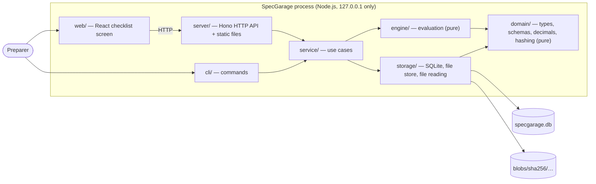

# Architecture

SpecGarage is one Node.js process on the user's computer, used from a desktop browser and from a command line. It needs no network and calls no external service. All data lives in one directory chosen by the user.

## System context

The browser bundle (`web/`) talks to the server only over HTTP and shares no code with it.

## Components

| Path           | Responsibility                                                                                                                        | May use                                               |
| -------------- | ------------------------------------------------------------------------------------------------------------------------------------- | ----------------------------------------------------- |
| `src/domain/`  | Types, the Zod rulepack schema, exact decimal arithmetic, statuses, canonical JSON and hashing, file-type detection, identifier rules | `node:crypto` only                                    |
| `src/engine/`  | Decide a requirement's status and reasons from its rule, observation, and evidence                                                    | `domain/`                                             |
| `src/storage/` | SQL migrations and triggers, the typed store, the content-addressed file store, rulepack and web asset file reading                   | `domain/`, file system, SQLite                        |
| `src/service/` | Use cases: import editions, register vehicles, start inspections, record observations, attach evidence, build the checklist           | `domain/`, `engine/`, `storage/`                      |
| `src/server/`  | HTTP routes, local-only guard, security headers, upload parsing, static file mapping                                                  | `domain/`, `service/`, `storage/` (web assets, types) |
| `src/cli/`     | Command parsing and output, `serve`                                                                                                   | all of the above                                      |
| `web/`         | The checklist screen, built with Vite and served as static files                                                                      | the HTTP API only                                     |

`tests/architecture.test.ts` enforces the table by scanning imports: domain and engine are pure, only storage touches SQLite and the file system (plus the one `.env` read in `cli/main.ts`), and the CLI and server stay thin over the service layer.

## Data flows

**Import an edition** (`rulepack import`). The CLI reads the file and its documents (paths confined to the rulepack's directory) → Zod validates structure and cross-references → each document is checked to be a PDF and hashed → the resolved rulepack is canonicalized and hashed into the edition id → identical content is a no-op, a reused label with different content is refused → files and the edition are written (files first, since they are addressed by hash).

**Record an observation.** The browser sends multipart form data → the server checks the request is local, limits size and count, and parses it → the service validates the entry against the rule (exact decimal, matching unit, known conditions, supported file types) → in one transaction it inserts the observation and its evidence, runs the engine against the pinned edition's requirement, and inserts the result with its rule snapshot, evidence ids, and engine version → the updated requirement is returned.

**Attach evidence.** Same path, but the request names the observation the files were prepared for; the service refuses it if that is no longer the current one ([ADR 0006](adr/0006-evidence-bound-to-observation.md)).

**Show the checklist.** The service loads the pinned edition, the current observation, evidence, and result of each requirement, and builds one view grouped by system. Requirements with no result are shown as Pending.

## Storage

SQLite through `node:sqlite` with STRICT tables, foreign keys, WAL, and `recursive_triggers` on.

| Table                        | Holds                                                                                 |
| ---------------------------- | ------------------------------------------------------------------------------------- |
| `rulepack_editions`          | Immutable editions: canonical JSON content under its SHA-256, category, season, label |
| `edition_documents`, `blobs` | Which stored file is each document of an edition; every stored file's size and type   |
| `vehicles`, `inspections`    | Internal vehicle codes; one vehicle at one event, pinned to one edition               |
| `observations`               | Every measurement or verdict ever recorded; the latest per requirement is current     |
| `evidence`                   | Files attached to one observation                                                     |
| `results`                    | Every evaluation, with the rule snapshot, evidence ids, and engine version            |

Triggers reject updates and deletes on all of them, and tie evidence and results to the observation they belong to. Files live at `blobs/sha256/<first two hex>/<hash>`; a file written before a failed transaction is harmless, since it is identified by its hash. See [ADR 0003](adr/0003-immutable-editions-append-only-history.md).

## Constraints

- The server binds to `127.0.0.1` and refuses non-local `Host`, `Origin`, and `Sec-Fetch-Site` values ([security.md](security.md)).
- The interface is served under a strict Content-Security-Policy with no third-party assets.
- Domain and engine code cannot read the clock or generate identifiers; the service layer injects them, so tests are deterministic.
- Timestamps are UTC from the local clock and are not tamper-proof.

## Not built yet

Authorized component lists, applicability conditions, exceptions, conflict detection, PDF text extraction, exports, closed dossiers, offline exchange, instruments, Spanish interface, and packaging are planned in [ROADMAP.md](../ROADMAP.md).

## Decisions

See [docs/adr/](adr/): local server plus browser UI, built-in SQLite, immutable editions with append-only history, the TypeScript 7 plus Biome toolchain, exact decimals, evidence bound to its observation, and the React and Vite interface.
