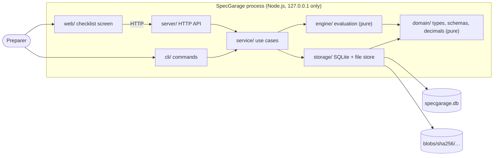

# Architecture

> **Status: design for the MVP (v0.1.0). Nothing described here is implemented yet.** This document is updated as each layer lands.

## System context

SpecGarage is one Node.js process on the user's computer, used from a desktop browser and from a command line. It needs no network and calls no external service. Data lives in a single directory chosen by the user.

## Components

| Path           | Responsibility                                                                               | Allowed to                                |
| -------------- | -------------------------------------------------------------------------------------------- | ----------------------------------------- |
| `src/domain/`  | Types, Zod rulepack schema, exact decimal arithmetic, statuses, canonical JSON and hashing   | Nothing with I/O                          |
| `src/engine/`  | Evaluate one requirement from its rule, observation, and evidence; return status and reasons | Nothing with I/O                          |
| `src/storage/` | Numbered SQL migrations, append-only tables, repositories, content-addressed file store      | Touch SQLite and the file system          |
| `src/service/` | Use cases: import edition, start inspection, record observation, build the checklist view    | Call engine and storage; own transactions |
| `src/server/`  | Hono routes, upload handling, local-only request checks, static files                        | Call service                              |
| `src/cli/`     | Command parsing and output                                                                   | Call service                              |
| `web/`         | React checklist screen built with Vite and served as static files                            | Call the HTTP API only                    |

## Data flows

**Import an edition.** CLI reads the rulepack file → Zod validates structure and cross-references → documents' files are hashed and stored → the resolved rulepack is canonicalized and hashed → storage inserts the edition (or reports it already exists) in one transaction.

**Record an observation.** UI sends a multipart request → server validates fields and sniffs each file's type → service stores files, then in one transaction inserts the observation and evidence, runs the engine against the pinned edition's requirement, and inserts the result with its rule snapshot → the updated requirement view is returned.

**Show the checklist.** Service loads the pinned edition, the latest result and current observation for each requirement, and builds one view for the screen. Requirements without results are shown as Pending.

## Storage

SQLite via `node:sqlite` with STRICT tables, foreign keys on, and WAL mode. Tables for editions, inspections, observations, evidence, results, and blobs; the history tables (`observations`, `evidence`, `results`, `inspections`, editions) reject updates and deletes through triggers. Files are stored under `blobs/sha256/<first two hex>/<hash>`; the database records each file's size and detected media type. A file written before a failed transaction is harmless: it is identified by its hash and can be reclaimed by the purge tool planned in Phase 17.

## Constraints

- The server binds to `127.0.0.1` and refuses requests whose `Host` or `Origin` is not local, which also blocks DNS-rebinding attempts.
- The UI is served with a strict Content Security Policy and no third-party assets.
- Uploads are limited in size, typed by file signature (never by name or declared type), and stored by hash.
- Timestamps are UTC from the local clock and are not tamper-proof; the documentation says so.
- Domain and engine code cannot read the clock; the service layer passes time in, so tests are deterministic.

## Decisions

See [docs/adr/](adr/): local server plus browser UI, built-in SQLite, immutable editions with append-only history, and the TypeScript 7 plus Biome toolchain.
